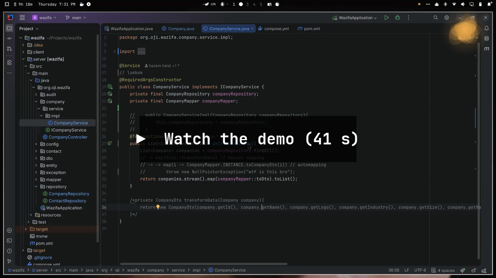

# Omarum

**A voice companion for [Omarchy](https://omarchy.org).** Press a key, a small glowing orb appears, and you talk with **Rum** out loud, like a friend in the room. Rum remembers you from day to day, can see the code you have open, and explains it to you. There's no chat window, only the orb and two voices.

[](docs/media/omarum-demo.mp4)

*The demo: Rum meets the user for the first time on an empty desktop, then explains a Spring Boot file open in IntelliJ. Click the picture to play it, with sound.*

---

## What it does

- **Talks with you, not at you.** Rum shares its own takes, jokes and disagrees. It isn't an assistant answering questions.
- **Remembers you.** After each conversation Rum keeps short notes about you, and writes a journal once a day. You can read, edit and delete all of it.
- **Meets you properly.** The first time you talk, Rum speaks first, gets to know you and chooses its own name.
- **Sees your code.** With IntelliJ (or another JetBrains IDE, or VS Code) focused, ask "what does this do?" and Rum explains the open file, one piece at a time.
- **Looks at your screen when you ask.** Say "look at my screen" or "what do you see?" and Rum takes one screenshot and talks about it. It never looks unless you ask.
- **Any brain.** Your Claude, Codex, Gemini, Kimi or Qwen subscription (through its own command-line tool), or any API key (Anthropic, OpenAI, Gemini, Groq, OpenRouter, DeepSeek, Mistral, xAI, Together), or a local model with Ollama.
- **Your choice of voice.** ElevenLabs (cloud), or local and free: ZONOS3-Mini or Kokoro. If one fails, Rum moves to the next.
- **Fits Omarchy.** It's one Omarchy plugin: an orb button in the bar, a panel, the orb overlay and a keyboard shortcut, all in your theme's colors.

## Install

You need:

- **Omarchy**
- **uv**: `omarchy pkg add uv`
- **A brain**: the default is the `claude` command-line tool, logged in to your Claude subscription. You can switch to any other in settings.

Then:

```bash
omarchy plugin add https://github.com/hazmr/omarum
```

The first time it loads, Omarum sets up its Python environment and downloads the speech models (about a minute; the panel shows the progress). After that, Rum starts with the Omarchy shell and restarts itself if it ever crashes.

## Talking to Rum

**Ctrl + Shift + Space** (you can keep Ctrl + Shift down the whole time; only Space counts):

- **Double tap Space:** open Rum, or close her, in any state: listening, thinking or talking.
- **Hold Space:** talk; let go and Rum answers, and stops listening. Holding while she talks stops her, and it's your turn.
- **One tap** never opens or closes her; while she's talking it just stops her.

**Or just say goodbye:** "bye", "good night", "that's all", "talk to you later". She answers with a short goodbye and closes. A conversation also closes by itself after a few seconds of silence.

**Talk mode** (settings → Talking): **Push to talk** (the default) means Rum hears you only while you hold Space, so the room around you never reaches her. **Hands-free** keeps the mic on after a double tap. For one conversation, right-click the orb in the bar or use the switch in its panel to go hands-free.

Background noise (fans, typing, the room) is filtered out of the mic before Rum listens, in both modes.

**The orb in the bar:**
- **Click:** the panel (hands-free switch, your brain and voice, your last conversation, settings).
- **Right-click:** hands-free on or off.
- **Middle-click:** settings.

**Asking about code:** keep your editor focused (just keep working in it), open the conversation, and ask "can you see what I have open?" or "what does this file do?". Rum gets the open file each time you speak, and only sends it again when the file changes.

**Showing Rum your screen:** say "look at my screen", "what do you see?" or "can you see this error?". Rum takes one screenshot of the monitor you're on, right then, and talks about it. This works with Claude and with the API brains; with other command-line brains Rum tells you it can't see images.

## Settings

Open settings with a middle-click on the orb. It's keyboard-first: **↑ ↓** to move, **← →** to change, **Enter** to edit, **Tab** for the next tab. The line at the bottom explains the row you're on.

- **Settings:** names, the brain (and its key, only if it needs one), the voice (every voice of every engine in one list) and its volume, **Processing**, response speed, the talk key, the orb's style and position, and whether Rum may look at your screen or your code.
- **Models:** every model Rum can download, with its size and state. **Enter** downloads it, or pauses a download (Enter again resumes where it stopped); **D** twice removes it. Downloads keep going if you close the window.
- **Memory:** what Rum knows about you (forget any line), the journal, and how long conversations are kept.
- **Conversations:** play back or delete past conversations.

### Processing: Fast or Accurate

How Rum turns your voice into text:

- **Fast:** Whisper Base on the CPU. Works on any computer.
- **Accurate:** Whisper Large v3 Turbo on an NVIDIA GPU. Much better with names and unusual words, and about half a second per sentence. It needs **GPU support** (581 MB, the NVIDIA cuBLAS libraries, downloaded into Omarum's own folder, no sudo); choosing Accurate downloads whatever is missing. Until it's ready, Rum uses Fast.

### Using ElevenLabs

1. On elevenlabs.io, go to **Profile → API keys → Create API key**, and turn on **Text to Speech** (and **Voices: Read** to also see your own voices).
2. Copy the key from the box that appears. **A real key starts with `sk_`.** The 64-character code in the key list is only its ID and won't work.
3. In settings, pick an ElevenLabs voice in **Voice**; the **ElevenLabs key** row appears under it: press Enter, paste, press Enter.
4. The bottom line shows "✓ works", or tells you in plain words what's wrong.

### ZONOS3-Mini (optional local voice)

Build it from [Zyphra/ZONOS3-Mini](https://github.com/Zyphra/ZONOS3-Mini) into `~/.local/share/omarum/engines/zonos3` (`cmake -B build-vulkan -DGGML_VULKAN=ON && cmake --build build-vulkan`, then `hf download Zyphra/ZONOS3-Mini` for the `gguf/` files). Rum uses it when it's there.

## Your data and privacy

- **Everything stays on your computer:** conversations, memory and settings live in `~/.local/share/omarum` and `~/.config/omarum`. API keys are in `~/.config/omarum/env`, readable only by you.
- **What leaves it:** what you say goes to the brain you chose, and Rum's replies go to the voice service you chose (if it's a cloud one). With "See my code" on, the open file goes to the brain too, and when you ask Rum to look at your screen, that one screenshot does. You can turn either off in settings → Screen.
- **Speech recognition** (Whisper) always runs locally.

## Remove

```bash
omarchy plugin remove omarum.panel
```

This stops Rum, the orb and the shortcut. Your conversations, memory and settings stay; delete `~/.local/share/omarum` and `~/.config/omarum` to remove them too.

## Troubleshooting

- **Rum doesn't answer, or the panel shows a red message:** the message says why, for example "Codex is not logged in. Run: codex login" or "Gemini needs an API key".
- **Rum can't see your code:** the editor must be the focused window when you speak, and the project should be one IntelliJ knows (or live in `~/Projects`, `~/IdeaProjects` or `~/Work`).
- **Rum interrupts you:** hold Ctrl+Shift+Space while you talk (she waits until you let go), or set **Response speed** to *patient* in settings.
- **Rum mishears you** (names, technical words): settings → **Processing → Accurate**. The log line `whisper: large-v3-turbo on cuda` means it's working; `Accurate needs GPU support` means the download isn't done yet, and an out-of-memory message means other apps are using the GPU.
- **Rum takes long to answer:** set **Response speed** to *fast*, or the brain's **Model** to `haiku`, in settings.
- **Logs:** `~/.local/state/omarum/daemon.log`

## Development

```bash
git clone https://github.com/hazmr/omarum && cd omarum
uv run pytest                                            # the tests
ln -s "$PWD" ~/.config/omarchy/plugins/omarum.panel       # run your checkout as the plugin
omarchy-shell shell rescanPlugins && omarchy plugin enable omarum.panel
```

How it fits together: the plugin (`plugin/`, QML) draws the orb and the panel, binds the keys, and runs Rum's engine (`omarum/`, Python 3.12 with [Pipecat](https://github.com/pipecat-ai/pipecat)) as a child process, talking to it over a Unix socket. The settings window (`settings/`) uses the system Python with GTK4.

## License

MIT
